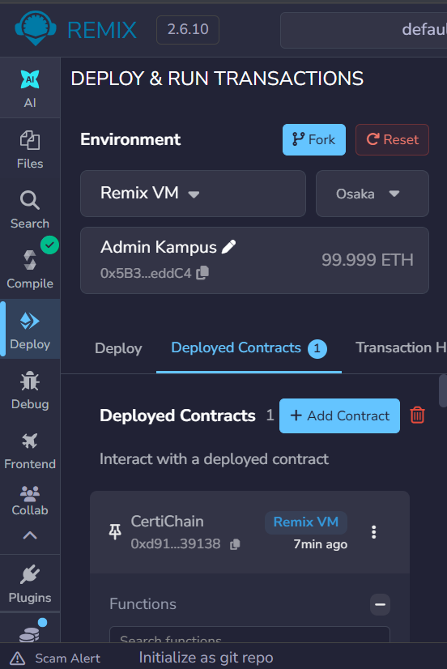
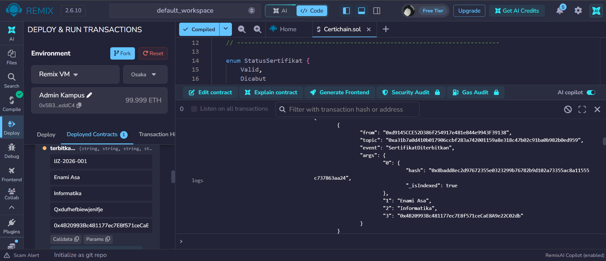

# 🎓 CertiChain: Sistem Verifikasi Sertifikat & Ijazah Digital Berbasis Blockchain

Proyek ini merupakan **Tugas Ujian Tengah Semester (UTS)** Mata Kuliah **Teknolgi & Rekayasa Blockchain (Berbasis Proyek)** yang telah diperbaiki sesuai panduan revisi UTS.


## 👥 Anggota Kelompok 7
- **Akhmad Febri Dimyati** (2530801094)
- **Moh. Ni'am Billi Yachsyi** (2530801024)
- **Agung Dwi Jaya** (2530801093)
- **Jouvan Labib** (2530801089)

## 📌 Informasi Proyek & Deployment
* **Mata Kuliah:** Teknologi & Rekayasa Blockchain
* **Dosen Pengampu:** Mohamad Firdaus, M.Kom.
* **Nama Kontrak:** `CertiChain`
* **File Contract:** `CertiChain.sol`
* **Compiler Solidity:** `v0.8.20`
* **Alamat Kontrak (Deployment):** `0x5B38Da6a701c568545dCfcB03FcB875f56beddC4`


## 🚀 Pengujian & Demonstrasi Fungsi Revisi

Berikut adalah dokumentasi hasil perbaikan dan demonstrasi pengujian fungsi-fungsi Smart Contract `CertiChain` di Remix IDE:

### 1. Compilation & Deployment Success
Menampilkan bukti bahwa Smart Contract `CertiChain.sol` berhasil di-compile tanpa error pada compiler `0.8.20` dan sukses di-deploy oleh akun Admin Kampus.

> **Dokumentasi Deployment:**




### 2. Fungsi `terbitkanIjazah` (Happy Path & Validasi Input)
Penerbitan ijazah baru oleh **Admin Kampus** yang mencatat nama pemilik, program studi, hash IPFS dokumen, serta mengaitkan langsung ke alamat dompet mahasiswa penerima.

* **Fungsi:** `terbitkanIjazah(string _nomorIjazah, string _namaPemilik, string _programStudi, string _hashDokumen, address _mahasiswa)`
* **Akses:** Hanya Admin Kampus (`onlyAdmin`)

> **Dokumentasi Penerbitan Ijazah:**


### 3. Fungsi `lihatIjazahMahasiswa` (Getter Mapping Address)
Fungsi *view/read-only* untuk menampilkan daftar seluruh nomor ijazah yang dimiliki oleh suatu alamat dompet mahasiswa secara instan dan bebas biaya *gas* (Free Gas).

* **Fungsi:** `lihatIjazahMahasiswa(address _mahasiswa)`
* **Output:** Array String `["IJZ-2026-001"]`

> **Dokumentasi View Ijazah Mahasiswa:**


### 4. Pengujian Keamanan & Simulasi Serangan (Revert Checks)
Pengujian skenario kegagalan (*negative test*) untuk membuktikan keandalan validasi kontrak:
1. **Akses Non-Admin:** Akun selain Admin memanggil `terbitkanIjazah` $\rightarrow$ Revert: `"Error: Hanya Admin Kampus yang memiliki akses!"`
2. **Input Kosong:** Memanggil `terbitkanIjazah` dengan nama/prodi/hash kosong $\rightarrow$ Revert: `"Nama pemilik wajib diisi"`
3. **Alamat Nol (Zero Address):** Memanggil `terbitkanIjazah` dengan `_mahasiswa = 0x0000000000000000000000000000000000000000` $\rightarrow$ Revert: `"Error: Alamat mahasiswa tidak boleh kosong!"`

> **Dokumentasi Revert Check / Simulasi Serangan:**

1. **Akses Non-Admin**


2. **Input Kosong**


3. **Alamat Nol (Zero Address)**


### 5. Log Events (`SertifikatDiterbitkan`)
Pancaran *Event* pada terminal Remix IDE untuk membuktikan pencatatan transaksi di-chain secara hemat gas fee.

> **Dokumentasi Logs Event:**




### 6. Fungsi `cabutIjazah` & `verifikasiIjazah` (Pencabutan & Jejak Audit On-Chain)
Proses pencabutan keabsahan ijazah oleh Admin jika terjadi pelanggaran, serta pengecekan ulang oleh HRD/Publik yang menampilkan status `isValid = false` beserta alasan dan *timestamp* pencabutan secara *on-chain*.

* **Fungsi Pencabutan:** `cabutIjazah(string _nomorIjazah, string _alasan)`
* **Fungsi Verifikasi:** `verifikasiIjazah(string _nomorIjazah)`

> **Dokumentasi Cabut & Verifikasi Ijazah:**

1. **Ijazah DiCabut**


2. **Verifikasi**


## 📁 Struktur Repository

```text
.
├── SmartContract/
│   └── CertiChain.sol           # Kode Sumber Smart Contract Solidity (v2.0)
├── Document/
│   └── Laporan_Revisi_UTS_Kelompok7.pdf  # Laporan Desain Arsitektur System (PDF)
├── assets/                      # Folder Gambar / GIF Demo Pengujian
│   ├── 01-deploy-success.gif
│   ├── 02-terbitkan-ijazah.gif
│   ├── 03-lihat-ijazah-mahasiswa.gif
│   ├── 04-revert-checks.gif
│   ├── 05-logs-event.gif
│   └── 06-cabut-verifikasi.gif
└── RevisiUTSKel_7.md            # Dokumentasi Proyek & Hasil Revisi